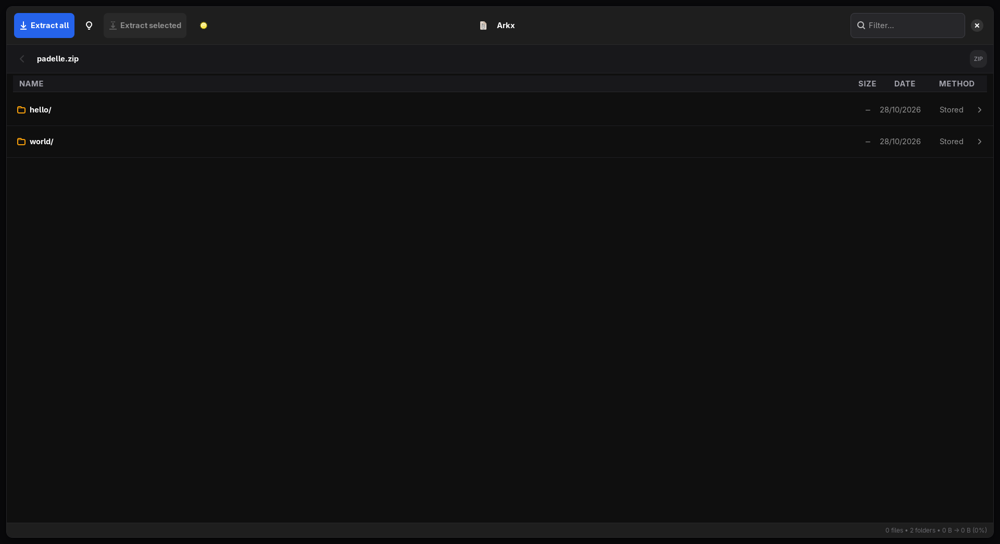

# Arkx

Fast, multi-threaded archive manager for Linux — open, browse and extract ZIP, 7Z, RAR, TAR and 20+ more formats, from a clean GTK4 interface or the terminal.

  



## Install

Grab the **AppImage** from [Releases](https://github.com/padelle2603/arkx/releases),
make it executable and run it:

```bash
chmod +x Arkx-*-x86_64.AppImage
./Arkx-*-x86_64.AppImage
```

No installer, no `sudo`, nothing written outside your home. Keep the file
wherever you like and re-download to update — or let [upkeep](https://github.com/padelle2603/upkeep)
do it for you.

## Use

```bash
# GUI — drag an archive in, or open one from your file manager
arkx
arkx archive.zip

# CLI
arkx l archive.7z                 # list contents
arkx x archive.7z ~/Downloads    # extract (all CPU threads)
arkx x archive.rar . -p secret   # RAR with password
arkx a archive.7z docs/ -l 9     # create an archive
arkx a archive.tar.zst docs/ --threads 4  # cap worker threads (or ARKX_THREADS=4)
arkx c --here --format=zip docs/ # compress (Dolphin-style, no overwrite)
arkx --check-update              # is a newer release out? 0=no 10=yes 1=offline
arkx --help                      # everything else
```

## Dolphin integration (replaces Ark's Compress menu)

Uninstalling Ark removes its right-click **Compress** entry (it was an Ark
plugin, not a Dolphin feature). Arkx restores it user-locally:

* Right-click folder/file → **Compress** → Compress to zip... / tar.gz... / 7zip...
* Right-click archive → **Extract** → Extract here / Extract to...

Headless by default (no window, no overwrite: `docs.zip`, `docs-2.zip`, …),
with desktop notification + highlight in Dolphin when done.
From the context menu Arkx shows the same progress window as the app
(bar with speed, ETA and Details); on success it closes itself, on error
it stays open with the message. `arkx compress --no-progress` forces
text mode (scripts, ssh).

### AppImage and Dolphin

Dolphin cannot see inside an AppImage, so the **Compress** and **Extract**
entries do not appear on the first run. Arkx registers them itself on the next
launch, user-locally and without sudo — nothing is installed outside your home
and nothing is registered system-wide. You should see a one-line confirmation:

```
registered ~/.local/share/kio/servicemenus/arkx-compress.desktop for Dolphin
```

If you moved the AppImage or ran `upkeep update arkx` (which can drop the
executable bit) and the menus stopped working, register them again:

```bash
arkx --appmenu-extract     # or: ./Arkx-*.AppImage --appmenu-extract
arkx --appmenu-remove      # remove them again
```

Restart Dolphin afterwards if it was open — it rescans the menu on KIO's
behalf when one of these runs, but only on the next start.
Right-click files inside an archive to extract just what you selected. Wrong password? Arkx asks again instead of failing.

## Features

- **Never hangs**: every job runs on a background worker; the UI stays fluid and anything can be cancelled
- **Honest progress**: a real byte-based 0%→100% bar with speed, ETA and a details pane (Windows copy-dialog style) — no fake percentages
- **Hybrid backends**: native Rust streaming for ZIP/TAR plus multithreaded `7z` for RAR/7Z/ISO/CAB and friends, with automatic fallback
- **File-manager feel**: breadcrumb navigation, live filter, dark responsive layout, drag & drop
- **Resilient**: corrupt archives warn instead of crashing; long/emoji/CJK names display fine
- **Checks before it writes**: an extraction that won't fit is confirmed up front, and entry names are refused if they would escape the destination

### Known limits

- **A 16 GiB decompression quota was removed.** Earlier versions refused to
  decompress past 16 GiB to stop zip bombs, which also blocked legitimate large
  games. Extraction now only checks free space up front — a small archive that
  expands to hundreds of GB will fill your disk.
- **Passwords passed to `7z`, `zip` and `rar` are visible in the process list**
  (`/proc/<pid>/cmdline` is world-readable). 7-Zip cannot read a password from
  stdin in non-interactive mode, so there is no way around this for the formats
  that route through it. ZIP and TAR extraction stay fully native.

## Build from source

```bash
sudo pacman -S gtk4 libadwaita 7zip libarchive   # or apt/dnf equivalents
cargo build --release
./target/release/arkx
```

Tests: `cargo test` · Lint: `cargo clippy`

The AppImage is built by GitHub Actions on every `v*` tag — there is no build
script in the repo. To try a packaging change before pushing, run
`.github/workflows/appimage.yml` with **workflow_dispatch**.

## Privacy & Legal

No accounts, no telemetry, no usage data. The only network call is one
anonymous check for a newer release at startup — see
[PRIVACY.md](PRIVACY.md) for exactly what it sends. License and third-party
notices: [LEGAL.md](LEGAL.md) (GPL-3.0).

*Developed with the assistance of [opencode](https://opencode.ai).*
